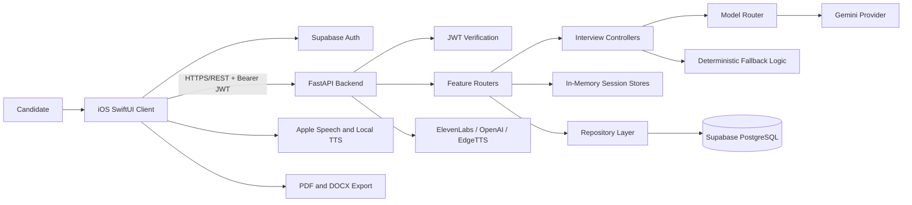
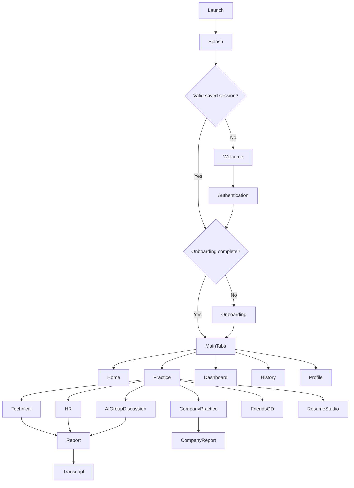
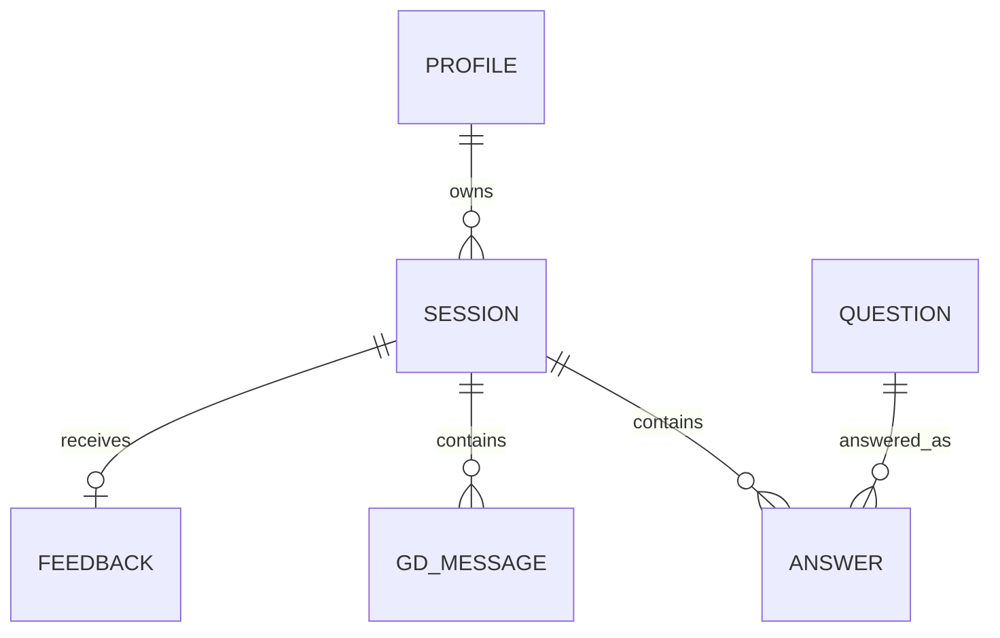

# Mockexa — Project Report Source Document

> Use this file as the factual source for generating an academic project report, synopsis, viva document, or technical documentation.  
> Verified against the local repository on **4 November 2026**.  
> Repository: <https://github.com/sunandanpuri0987/Mockexa>  
> Last pushed baseline inspected: `775617b` (`Make fresh-clone setup reproducible`).  
> The local working copy also contains ongoing changes newer than that commit. Do not describe the Git working state in the final academic report unless specifically requested.

---

## 1. Instructions for the Report Writer

Use only the information in this document and any screenshots or college format supplied by the student. Do not invent:

- user statistics, adoption numbers, accuracy percentages, financial results, or production traffic;
- deployment claims, App Store availability, commercial customers, or institutional partnerships;
- research-paper citations that have not been independently verified;
- test results other than those explicitly recorded here;
- features marked as limitations or future scope;
- team-member names, guide names, enrollment numbers, or college details.

When details are missing, insert a visible placeholder such as `[STUDENT NAME]` instead of guessing.

Preferred description: **“a functional, production-oriented academic prototype”** rather than “a fully deployed production system.”

---

## 2. Student and Institution Details to Fill

| Field | Value |
|---|---|
| Project title | Mockexa: AI-Powered Interview and Placement Preparation Platform |
| Student name | `[STUDENT NAME]` |
| University roll number | `[ROLL NUMBER]` |
| Registration/enrollment number | `[ENROLLMENT NUMBER]` |
| Degree and branch | `[DEGREE / BRANCH]` |
| Semester/year | `[SEMESTER / YEAR]` |
| College/university | `[INSTITUTION NAME]` |
| Department | `[DEPARTMENT NAME]` |
| Project guide | `[GUIDE NAME AND DESIGNATION]` |
| Academic session | `[ACADEMIC SESSION]` |
| Submission date | `[SUBMISSION DATE]` |
| Team members, if any | `[TEAM MEMBER DETAILS OR “INDIVIDUAL PROJECT”]` |

---

## 3. Executive Summary

**Mockexa** is a native iOS interview and placement-preparation application supported by a Python FastAPI backend. It provides structured practice for technical interviews, HR/behavioral interviews, AI-panel group discussions, company-specific interview questions, resume preparation, speech-based practice, session history, analytics, and selected social/group-discussion features.

The system combines:

- a native **SwiftUI iOS application**;
- an asynchronous **FastAPI REST backend**;
- **Supabase Authentication** and optional Supabase PostgreSQL persistence;
- Google **Gemini** integration with deterministic fallback evaluators;
- optional ElevenLabs and OpenAI neural text-to-speech providers, with EdgeTTS fallback;
- native speech recognition, PDF generation, and DOCX generation on iOS.

Its main purpose is to reduce the fragmentation of placement preparation. Instead of requiring candidates to use unrelated tools for mock interviews, group discussions, resume checking, company-question practice, and progress tracking, Mockexa provides these workflows through one account-aware mobile interface.

---

## 4. Abstract

Interview preparation generally requires candidates to practice several different skills: technical reasoning, behavioral communication, group discussion, company-specific questions, resume presentation, and verbal delivery. Existing preparation methods are often static, fragmented, or unable to provide immediate structured feedback. Mockexa addresses this problem through an integrated native iOS application and REST-based backend.

The platform supports adaptive technical interviews, STAR-oriented HR interviews, multi-persona group discussions, sourced company-question drills, resume construction and ATS-oriented analysis, session history, performance summaries, and voice interaction. The backend uses FastAPI, Pydantic schemas, authenticated endpoints, task-specific controllers, in-memory session stores, and optional Supabase persistence. AI-assisted evaluation is routed through Gemini where configured, while deterministic fallback logic keeps core practice flows usable when external AI credentials are unavailable. The iOS client uses SwiftUI and an MVVM-style separation of views, observable state, API models, and services.

The verified local test suite contains **157 passing backend tests**. A native iOS Simulator build also completed with `BUILD SUCCEEDED` on 4 November 2026. The result is a functional academic prototype that demonstrates mobile application development, secure authentication, REST API design, AI-provider abstraction, adaptive assessment, document generation, voice processing, and user-specific history management.

**Keywords:** interview preparation, placement readiness, SwiftUI, FastAPI, artificial intelligence, Gemini, Supabase, group discussion, behavioral interview, resume analysis, speech recognition.

---

## 5. Problem Statement

Students and early-career candidates often prepare for placements using disconnected resources. Technical questions may be practiced on one platform, behavioral questions through static lists, group discussions without realistic participants, and resumes through separate document tools. Common shortcomings include:

1. lack of a single personalized preparation workflow;
2. limited immediate feedback on answer quality;
3. insufficient practice for speaking, discussion, and behavioral storytelling;
4. little continuity between practice history and performance analytics;
5. generic preparation that does not reflect target-company question patterns;
6. difficulty producing an ATS-friendly resume and connecting it with interview preparation;
7. dependence on paid AI services without a reliable fallback path.

Mockexa is designed to provide an integrated, authenticated, mobile-first environment that addresses these needs.

---

## 6. Project Objectives

### 6.1 Primary Objective

To design and implement an AI-assisted iOS platform that helps candidates practice, evaluate, and improve multiple placement-readiness skills within one application.

### 6.2 Specific Objectives

1. Provide adaptive technical interview questions across major computer-science domains.
2. Evaluate HR answers using STAR-oriented behavioral dimensions.
3. Simulate group discussions using multiple AI personas and contextual turn-taking.
4. Provide company-specific, source-backed question practice.
5. Support authenticated accounts and user-isolated session history.
6. Present scores, strengths, weaknesses, transcripts, and progress summaries.
7. Allow users to create, analyze, tailor, preview, and export resumes.
8. Support voice input and spoken interviewer responses.
9. Keep important practice paths usable through deterministic fallbacks if cloud AI is unavailable.
10. Maintain modularity so AI providers, persistence, and client configuration can evolve independently.

---

## 7. Scope

### 7.1 Included Scope

- Native iOS 17+ client.
- Email/password, Google OAuth, Apple Sign In, and phone-authentication UI flows through Supabase.
- Onboarding and user preferences.
- Technical, HR, GD, and company-practice modes.
- Friends-room and matchmaking-oriented GD workflows.
- Resume builder, ATS checks, tailoring suggestions, PDF export, and DOCX export.
- Speech recognition, local speech synthesis, and optional neural TTS.
- Authenticated session reports, transcripts, and analytics.
- In-memory persistence for local development and optional Supabase persistence.
- Automated backend testing.

### 7.2 Out of Scope or Not Fully Implemented

- App Store distribution and production deployment evidence.
- A web or Android client.
- Real code execution in an isolated judge or sandbox; technical code answers are evaluated through static reasoning rather than execution against test cases.
- Durable, horizontally scalable multiplayer infrastructure; current friends/matchmaking state is primarily process-local.
- Guaranteed offline operation for cloud-authenticated and AI-powered features.
- Independent empirical validation of scoring against professional human interviewers.
- Included local LoRA weight file; large model weights are intentionally excluded from Git.

---

## 8. Target Users

- college students preparing for campus placements;
- software-engineering candidates preparing for internships or full-time roles;
- candidates improving HR/behavioral communication;
- users preparing for group discussions;
- candidates tailoring resumes for job descriptions;
- placement cells or mentors using the app as a guided practice aid.

---

## 9. Development Methodology

The project follows an iterative, module-oriented implementation approach:

1. define a practice mode and its request/response schemas;
2. implement backend controller and route logic;
3. create typed Swift API models and view models;
4. build the SwiftUI workflow;
5. add deterministic fallbacks for external-service failures;
6. test authentication, ownership, validation, session flow, and reports;
7. integrate the completed mode with history and analytics;
8. verify backend tests and the native Xcode build.

The code structure supports separation of concerns through routers, controllers, schemas, providers, repositories, models, services, view models, and views.

---

## 10. Technology Stack

| Layer | Technologies |
|---|---|
| Mobile client | Swift 5, SwiftUI, Foundation, Combine-style `ObservableObject` state |
| Minimum mobile target | iOS 17.0 |
| Networking | `URLSession`, REST, JSON, Codable DTOs |
| Secure local storage | iOS Keychain |
| Voice input | Speech framework / `SFSpeechRecognizer`, `AVAudioEngine` |
| Local speech output | `AVSpeechSynthesizer` |
| Resume PDF | CoreGraphics/PDFKit-based native generation |
| Resume DOCX | Native XML/ZIP package construction |
| Backend | Python 3.10+, FastAPI, Uvicorn, Pydantic |
| Authentication | Supabase Auth, bearer JWT, HS256 or RS256/ES256 JWKS verification |
| Persistence | Process-local stores; optional Supabase PostgreSQL/PostgREST |
| Primary AI provider | Google Gemini through an internal provider abstraction |
| Optional TTS providers | ElevenLabs, OpenAI, EdgeTTS fallback |
| Optional local ML | PyTorch, Transformers, PEFT, Accelerate; model weights separate |
| Testing | Pytest, FastAPI/Starlette TestClient, HTTPX |
| Version control | Git and GitHub |

---

## 11. High-Level Architecture



### 11.1 Architecture Style

- **Client-server architecture:** mobile app and API communicate using JSON REST endpoints.
- **MVVM-style iOS organization:** SwiftUI views consume observable application and feature state.
- **Layered backend:** API routers call controllers, provider abstractions, stores, and repositories.
- **Provider abstraction:** AI tasks are routed without tightly coupling every feature to a vendor.
- **Fallback-oriented design:** deterministic evaluation is available for key paths.

---

## 12. iOS Application Architecture

### 12.1 Main Source Files

| File | Responsibility |
|---|---|
| `UI/Mockexa/MockexaApp.swift` | Application entry point, global app/auth state, OAuth callback routing |
| `RootAndOnboarding.swift` | Splash, welcome, authentication, phone flow, onboarding |
| `MainScreens.swift` | Tabs, home, dashboard, leaderboard, history, profile and settings |
| `PracticeFlows.swift` | Technical, HR, AI-panel GD setup/live/report/transcript screens |
| `InterviewViewModels.swift` | Interview session state and API orchestration |
| `CompanyQuestionBank.swift` | Company catalog, filters, questions, practice, reviews and report |
| `FriendsGD.swift` | Friends rooms, matchmaking, contributions and rewards UI |
| `ResumeModels.swift` | Resume domain models and ATS result models |
| `ResumeService.swift` | Resume improvement service logic |
| `ResumeViewModel.swift` | Resume state, persistence, analysis and tailoring orchestration |
| `ResumeViews.swift` | Resume forms, previews, ATS result and tailoring UI |
| `PDFExportService.swift` | Native PDF generation |
| `DOCXExportService.swift` | Editable DOCX package generation |
| `VoiceFoundation.swift` | Speech recognition, audio monitoring, silence handling and playback |
| `LanguageValidator.swift` | English/Hinglish/Devanagari-oriented input checks |
| `APIClient.swift` | REST requests, authorization header and error mapping |
| `APISchemas.swift` | Codable API request/response data transfer objects |
| `AuthManager.swift` | Supabase authentication, session refresh, Keychain and metadata sync |
| `Config.swift` | Backend and Supabase client configuration resolution |
| `DesignSystem.swift` | Themes, cards, buttons, animation, haptics and score components |

### 12.2 Navigation Flow



---

## 13. Backend Architecture

### 13.1 Main Packages

```text
Backend/app/
├── main.py                 FastAPI setup and router registration
├── config.py               Environment-based settings
├── auth.py                 JWT validation and user extraction
├── repository.py           Supabase PostgREST access
├── error_handlers.py       JSON error response handling
├── routers/                HTTP endpoint definitions
├── controllers/            Domain rules and evaluation engines
├── providers/              Gemini/model routing abstractions
├── schemas/                Pydantic API contracts
├── data/                   Company catalog and questions
└── utils/                  Session storage, locks and token budgets
```

### 13.2 Request Lifecycle

1. The iOS client sends JSON and a Supabase bearer token.
2. FastAPI validates the request with a Pydantic schema.
3. Authentication extracts and verifies the JWT user identity.
4. The router loads only a session owned by that user.
5. A controller performs question selection, evaluation, or discussion logic.
6. The model router invokes Gemini when configured and appropriate.
7. A deterministic evaluator or fallback handles unavailable/invalid AI output.
8. The route returns a typed response and records completed-session data.
9. History is loaded from local completed sessions and optionally Supabase.

---

## 14. Functional Modules

### 14.1 Authentication and Onboarding

Implemented capabilities include:

- email and password registration/login;
- Google OAuth through `ASWebAuthenticationSession`;
- callback URL `mockexa://auth/callback`;
- native Apple authorization flow with Supabase token exchange;
- phone OTP-related interface and verification requests;
- access/refresh token session handling;
- Keychain-backed session persistence under Mockexa-specific keys;
- user-scoped onboarding state and profile metadata sync;
- sign-out and session cleanup.

The iOS app communicates directly with Supabase Auth for authentication. The backend does not issue user tokens; it verifies tokens attached to API calls.

### 14.2 Technical Interview Module

The module supports configurable role, experience, selected domains, difficulty, practice mode, and question count.

Core behaviors:

- question-bank filtering;
- no repetition within a session;
- balancing across selected domains;
- adaptive difficulty based on performance/proficiency state;
- answer analysis for correctness, completeness, relevance and reasoning;
- missing-concept and misconception reporting;
- final report and transcript generation;
- user ownership checks for every session operation.

Primary selectable domains represented in the project include Data Structures, Algorithms, Operating Systems, DBMS, OOP, Software Engineering, and Programming. Static reasoning can assess coding answers, but code is not executed inside a sandbox.

### 14.3 HR and Behavioral Interview Module

The HR module focuses on behavioral questions and STAR-style responses.

Seven evaluation dimensions are represented:

1. clarity;
2. specificity;
3. ownership;
4. communication;
5. teamwork;
6. leadership;
7. problem solving.

The user receives per-answer feedback and a consolidated performance report.

### 14.4 AI-Panel Group Discussion

The GD engine creates a structured discussion with four distinct participant profiles. The implementation supports:

- custom topic and duration/round configuration;
- automatic opening turn;
- contextual AI responses to candidate contributions;
- multiple viewpoints and persona-guided speaking style;
- balanced and consensus-oriented behavior;
- grounding/verification to reduce false attribution of statements;
- interruption/context signals;
- per-session concurrency locks;
- end-of-session metrics, summary and transcript.

The discussion manager, evaluator, provider router and verifier are separated so each can be tested or replaced independently.

### 14.5 Friends and Online Group Discussion

The friends GD controller and client UI support:

- private room creation;
- joining with a room code;
- room-status polling;
- participant ready state;
- host-controlled start;
- contribution submission;
- session finish;
- matchmaking join/status/cancel operations;
- reward wallet;
- leaderboard;
- reward redemption.

Current multiplayer state is primarily in-memory and is suitable for a single backend process/demo. Durable distributed presence is future work.

### 14.6 Company-Specific Practice

The current source-backed catalog contains:

- **12 companies**;
- **48 questions**;
- four categories: DSA, Technical, System Design and Behavioral.

Companies currently represented:

1. Google
2. Amazon
3. Microsoft
4. Apple
5. Meta
6. Adobe
7. Flipkart
8. Atlassian
9. Accenture
10. Deloitte
11. JPMorgan
12. Goldman Sachs

Each question record includes provenance metadata, category, role, round, year, difficulty, focus points and an answer outline. Public browsing responses do not expose the answer outline before review.

Practice supports:

- company/category/role filtering;
- randomized questions;
- fast evidence-based evaluation;
- optional bounded Gemini evaluation;
- deterministic fallback when AI is unavailable or times out;
- reviewed-question answer outline and focus points after submission;
- category score, strengths and focus areas;
- completed-session history integration;
- reward integration.

### 14.7 Resume Builder and ATS Tools

The native resume workspace supports:

- personal information;
- summary;
- education;
- categorized skills;
- projects;
- experience;
- certifications;
- achievements;
- positions of responsibility;
- languages;
- extracurricular activities;
- coursework;
- volunteering;
- saved resume profiles;
- preview templates;
- ATS-oriented section checks and optimization suggestions;
- job-description tailoring suggestions;
- AI-assisted bullet improvement;
- PDF export;
- editable DOCX export.

ATS scoring is a heuristic aid and should not be described as a guarantee of acceptance by any employer’s ATS.

### 14.8 Voice and TTS

The voice foundation provides:

- native speech-to-text;
- microphone power monitoring;
- silence detection and automatic response commit;
- persona-specific local speech synthesis;
- backend neural TTS requests;
- audio playback and error fallback;
- sanitization of text before speech generation.

The backend TTS route can use configured ElevenLabs or OpenAI providers and fall back to EdgeTTS. Provider availability depends on credentials and network access.

### 14.9 Dashboard, History and Reports

The application calculates user-facing summaries from fetched sessions, including:

- average readiness score;
- mode-specific averages;
- company-practice average;
- best score;
- recent-session history;
- session detail;
- transcript;
- leaderboard and reward views.

History merges completed in-memory sessions with Supabase-backed sessions when durable persistence is enabled.

---

## 15. Important Algorithms and Logic

### 15.1 Adaptive Technical Question Selection

Conceptual sequence:

```text
Input: selected domains, candidate proficiency, asked question IDs
1. Remove questions already asked in the current session.
2. Find the least represented selected domain.
3. Convert current domain proficiency into a target difficulty from 1 to 5.
4. Find available questions closest to that target difficulty.
5. Randomly choose among equally suitable candidates.
6. Update session history after the answer is evaluated.
```

This avoids repetition while balancing domain coverage and difficulty.

### 15.2 Company Fast Evaluator

The low-latency evaluator uses observable evidence rather than claiming full semantic understanding. It considers:

- answer length and development;
- overlap with question and focus concepts;
- category-specific vocabulary;
- reasoning markers such as examples, trade-offs and complexity;
- metrics or quantitative evidence;
- STAR-related structure and ownership for behavioral questions.

Weighted components produce correctness, completeness, relevance, reasoning and overall scores. The result is categorized as correct, mostly correct, partially correct, irrelevant, incorrect, or insufficient evidence. Gemini can be used as an opt-in deep evaluator, with the fast evaluator retained as a fallback.

### 15.3 HR Evaluation

HR answers are evaluated through STAR-related signals and seven behavioral dimensions. The final report aggregates multiple question evaluations to identify strengths and development areas.

### 15.4 GD Turn Generation

```text
Start session
→ create discussion manager and participant profiles
→ select next speaker based on discussion state
→ construct task-specific prompt with recent context
→ generate response through the model router
→ verify/ground the response
→ append turn under a per-session lock
→ update positions and metrics
→ return typed response to iOS
```

### 15.5 ATS Heuristic Analysis

Resume analysis uses section completeness, bullet quality, action verbs, quantification, formatting/readability indicators and role/job-description alignment. It provides guidance, not a certified ATS score.

---

## 16. API Inventory

All paths below are relative to the backend base URL. Except `/health`, the feature routes use bearer authentication.

### 16.1 Core Interview and History APIs

| Method | Endpoint | Purpose |
|---|---|---|
| GET | `/health` | Backend status and environment health |
| POST | `/technical/start` | Start technical interview |
| POST | `/technical/answer` | Submit technical answer and receive analysis/next question |
| POST | `/technical/finish/{session_id}` | Complete technical session |
| POST | `/hr/start` | Start HR interview |
| POST | `/hr/answer` | Submit HR answer |
| POST | `/hr/finish/{session_id}` | Complete HR session |
| POST | `/gd/start` | Start AI-panel GD |
| POST | `/gd/respond` | Submit/fetch a GD turn |
| POST | `/gd/finish/{session_id}` | Complete and score GD |
| GET | `/sessions` | List authenticated user’s completed sessions |
| GET | `/sessions/{session_id}` | Fetch user-owned report and transcript |
| POST | `/tts` | Generate speech audio |

### 16.2 Company APIs

| Method | Endpoint | Purpose |
|---|---|---|
| GET | `/company/companies` | Company catalog |
| GET | `/company/{company_id}/questions` | Filtered public questions |
| POST | `/company/start` | Start company practice |
| POST | `/company/answer` | Evaluate answer and reveal review data |
| POST | `/company/finish/{session_id}` | Finish company practice and save report |

### 16.3 Friends GD and Reward APIs

| Method | Endpoint | Purpose |
|---|---|---|
| POST | `/gd/friends/rooms` | Create room |
| POST | `/gd/friends/join` | Join room |
| GET | `/gd/friends/rooms/{room_id}` | Room status |
| POST | `/gd/friends/rooms/{room_id}/ready` | Update ready state |
| POST | `/gd/friends/rooms/{room_id}/start` | Start room session |
| POST | `/gd/friends/rooms/{room_id}/contributions` | Add contribution |
| POST | `/gd/friends/rooms/{room_id}/finish` | Finish room session |
| POST | `/gd/friends/matchmaking` | Enter matchmaking |
| GET | `/gd/friends/matchmaking/status` | Matchmaking status |
| DELETE | `/gd/friends/matchmaking` | Cancel matchmaking |
| GET | `/gd/rewards/wallet` | Reward wallet |
| GET | `/gd/rewards/leaderboard` | Leaderboard |
| POST | `/gd/rewards/redeem` | Redeem a reward |

---

## 17. Data and Persistence Design

### 17.1 Process-Local Stores

Local development and several interactive flows use user-owned in-memory stores for:

- technical sessions;
- HR sessions;
- GD sessions;
- company sessions and cached reports;
- completed-session summaries/details;
- friends rooms and matchmaking state;
- rewards and leaderboard state;
- per-session async locks.

These stores simplify local development and deterministic testing but reset when the backend process restarts.

### 17.2 Supabase Repository

The repository layer accesses Supabase through PostgREST and passes the caller’s JWT so Row Level Security can apply. Tables referenced by the repository include:

- `profiles`;
- `questions`;
- `sessions`;
- `answers`;
- `gd_messages`;
- `feedback`.

Typical relationships:



The exact production SQL schema and RLS policies should be attached separately if the college report requires database DDL.

---

## 18. Security Design

Implemented controls include:

1. bearer JWT verification on protected APIs;
2. support for HS256 legacy/local verification and RS256/ES256 JWKS verification;
3. user identity derived from the verified `sub` claim;
4. session stores scoped by owner user ID;
5. session-detail ownership checks;
6. Supabase caller JWT forwarding so RLS can enforce database isolation;
7. Keychain storage for mobile authentication sessions;
8. `.env` exclusion from Git;
9. no backend service-role key embedded in the iOS app;
10. bounded input models and error handling;
11. OAuth callback through a registered custom URL scheme.

Security caveats for an academic report:

- the Supabase anon key is a public client credential, while JWT secrets and service-role keys must remain server-only;
- production CORS must be restricted instead of using development wildcard settings;
- local HTTP is allowed for development networking and should be replaced by HTTPS in deployment;
- rate limiting, centralized abuse prevention and production secret rotation remain deployment responsibilities;
- custom URL schemes should be reviewed against universal-link/app-link alternatives for production hardening.

---

## 19. Non-Functional Requirements

### 19.1 Usability

- native iOS interaction patterns;
- clear practice-mode separation;
- reusable design system;
- accessibility-aware motion settings;
- visible loading, error, score and completion states.

### 19.2 Performance

- asynchronous backend endpoints;
- bounded AI timeouts/retries;
- deterministic fast evaluator;
- TTS response cache;
- batch history feedback lookup;
- local session state for low-latency practice;
- token budgets to constrain AI input/output.

### 19.3 Reliability

- provider fallbacks;
- validation of structured AI output;
- per-session locks;
- idempotent/cached finish behavior in relevant flows;
- ownership checks and typed error responses;
- automated tests.

### 19.4 Maintainability

- router/controller/schema/provider separation;
- shared Swift DTOs and API client;
- centralized environment configuration;
- feature-oriented Swift files;
- reusable theme and interaction components.

### 19.5 Portability

- repository can be cloned on another Mac;
- secrets are supplied through ignored environment configuration;
- generated build folders and Xcode user state are excluded;
- Simulator uses loopback to reach a backend running on the same Mac;
- physical devices require a reachable LAN hostname/IP or deployed HTTPS URL.

---

## 20. Testing and Verification

### 20.1 Latest Verified Result

Verification date: **4 November 2026**

```text
Backend test suite: 157 passed
iOS simulator target build: BUILD SUCCEEDED
```

The build produced an Xcode/CoreSimulator version warning on the verification Mac, but source compilation, linking, app validation and final build completion succeeded.

### 20.2 Backend Test Coverage Areas

- health route;
- authentication and invalid/expired tokens;
- cross-user isolation;
- technical interview start/answer/finish;
- HR interview flow;
- GD generation, progression, validation and finish;
- company catalog, filters, answer review and reports;
- company-session inclusion in history;
- friends rooms, matchmaking, rewards and leaderboard;
- session history and detail;
- repository behavior;
- token budgeting;
- model routing and provider fallbacks;
- TTS provider/fallback/cache behavior;
- iOS-readiness JSON error responses.

### 20.3 Verification Commands

```bash
# Backend tests
Backend/.venv/bin/python -m pytest Backend/tests -q

# iOS Simulator build
xcodebuild \
  -project UI/Mockexa.xcodeproj \
  -scheme Mockexa \
  -sdk iphonesimulator \
  -configuration Debug \
  -destination 'generic/platform=iOS Simulator' \
  CODE_SIGNING_ALLOWED=NO \
  build
```

### 20.4 Testing Limitations

- automated tests do not prove real-world scoring accuracy;
- external provider quality and uptime are outside local test control;
- physical-device microphone, Apple Sign In and provider dashboards require separate manual verification;
- a successful build is not the same as App Store approval;
- load, penetration and large-scale concurrency testing are not documented as completed.

---

## 21. Local Installation and Execution

### 21.1 Prerequisites

- macOS 14 or later;
- Xcode with iOS 17+ SDK;
- Git;
- Python 3.10 or later;
- internet access for initial dependencies and cloud providers.

### 21.2 Clone

```bash
git clone https://github.com/sunandanpuri0987/Mockexa.git
cd Mockexa
```

### 21.3 Backend

```bash
cd Backend
python3 -m venv .venv
source .venv/bin/activate
python -m pip install --upgrade pip
pip install -r requirements.txt
cp .env.example .env
```

Fill private values in `Backend/.env`. Do not include real credentials in a report or Git commit.

```bash
uvicorn app.main:app --host 0.0.0.0 --port 8000 --reload
```

Health URL: `http://127.0.0.1:8000/health`  
Swagger UI: `http://127.0.0.1:8000/docs`

### 21.4 iOS Simulator

```bash
open UI/Mockexa.xcodeproj
```

Select the `Mockexa` scheme, select an iOS Simulator, keep the backend running, and press `Cmd + R`.

### 21.5 Physical iPhone

- choose the developer’s own Apple signing team;
- use a unique bundle identifier if required;
- run the backend on `0.0.0.0`;
- connect the Mac and iPhone to the same network;
- configure `MOCKEXA_BACKEND_BASE_URL` or the in-app override with the Mac’s reachable LAN IP/Bonjour hostname;
- do not use `127.0.0.1` on a physical phone, because it refers to the phone;
- allow local-network/firewall access;
- configure Supabase redirect URL `mockexa://auth/callback`.

---

## 22. Results and Achievements

The project demonstrates the successful integration of:

- a native multi-screen iOS application;
- authenticated REST communication;
- adaptive technical interview state;
- structured HR evaluation;
- multi-agent GD orchestration;
- company-specific practice with provenance;
- user-isolated reports and transcripts;
- voice recognition and multi-provider TTS;
- resume analysis and native PDF/DOCX export;
- fallback behavior for unavailable AI services;
- automated backend validation across 157 tests.

These are implementation results. They should not be converted into claims about placement success, hiring rates, or scoring accuracy without a separate user study.

---

## 23. Limitations

1. External AI, authentication and neural-voice features require network services and correct credentials.
2. AI output may be inconsistent and should be treated as practice feedback, not authoritative hiring advice.
3. Deterministic scoring uses heuristics and may not understand every technically valid answer.
4. Coding answers are not executed in a secure judge.
5. In-memory sessions, friends rooms and rewards do not survive server restart unless migrated to durable persistence.
6. A local backend on a physical iPhone depends on LAN reachability and firewall configuration.
7. GD generation currently uses Gemini; the experimental local LoRA adapter was removed because it did not meet interactive latency and evaluation requirements.
8. The project currently targets iOS only.
9. Production monitoring, rate limiting, deployment automation, privacy policy and App Store compliance need further work.
10. The scoring system has not been presented as clinically or scientifically validated.

---

## 24. Future Scope

Recommended future enhancements:

1. deploy the backend behind HTTPS with managed secrets and monitoring;
2. migrate all interactive/multiplayer state to durable shared storage;
3. add WebSocket-based real-time rooms and presence;
4. add a secure code-execution sandbox with language-specific test cases;
5. perform evaluator calibration against expert interviewer ratings;
6. add rubric versioning and explainable score evidence;
7. develop Android and web clients;
8. add faculty/mentor dashboards and batch analytics;
9. add spaced repetition and personalized learning plans;
10. add notification scheduling and practice streaks;
11. improve accessibility, localization and low-bandwidth modes;
12. add CI/CD, load testing, security testing and observability;
13. support universal links and additional OAuth hardening;
14. add consent-based research analytics and user feedback studies;
15. add secure resume cloud sync and version history.

---

## 25. Suggested Academic Report Chapter Structure

Use the college’s required format if provided. Otherwise:

1. Title Page
2. Certificate
3. Student Declaration
4. Acknowledgement
5. Abstract
6. Table of Contents
7. List of Figures
8. List of Tables
9. Chapter 1 — Introduction
   - background
   - problem statement
   - objectives
   - scope
   - significance
10. Chapter 2 — Literature Survey / Existing Systems
   - interview-preparation platforms
   - conversational AI in education
   - automated assessment
   - resume/ATS tools
   - identified gaps
11. Chapter 3 — Requirements and Feasibility
   - functional requirements
   - non-functional requirements
   - hardware/software requirements
   - technical, operational and economic feasibility
12. Chapter 4 — System Analysis and Design
   - architecture
   - use-case diagram
   - data-flow diagrams
   - sequence diagrams
   - database/ER design
   - API design
13. Chapter 5 — Implementation
   - iOS architecture
   - backend architecture
   - authentication
   - interview modules
   - resume and voice modules
14. Chapter 6 — Testing and Results
   - testing strategy
   - representative test cases
   - verified results
   - screenshots
15. Chapter 7 — Security, Limitations and Ethical Considerations
16. Chapter 8 — Conclusion and Future Scope
17. References
18. Appendices
   - setup guide
   - API inventory
   - selected code snippets
   - test output

---

## 26. Suggested Diagrams

Ask the report writer to produce Mermaid first, then convert to images if the college template requires them.

Recommended figures:

1. overall client-server architecture;
2. authentication and onboarding flowchart;
3. use-case diagram for candidate actions;
4. technical interview sequence diagram;
5. GD sequence diagram;
6. company practice sequence diagram;
7. session-history data flow;
8. logical ER diagram;
9. backend component diagram;
10. iOS MVVM/component diagram;
11. deployment diagram for Simulator and physical iPhone;
12. testing workflow.

Do not invent database columns beyond those supported by the repository/schema supplied to the writer.

---

## 27. Screenshot Checklist

The student should capture real screenshots and label them. Suggested screenshots:

1. splash/welcome screen;
2. login or signup screen with private information hidden;
3. onboarding steps;
4. home screen;
5. practice hub;
6. technical setup and live question;
7. HR question and voice answer interface;
8. AI-panel GD screen;
9. GD report;
10. company catalog and question filter;
11. company answer review;
12. resume builder;
13. ATS score/result;
14. PDF or DOCX preview;
15. dashboard;
16. history and session detail;
17. Swagger API documentation;
18. `157 passed` test output;
19. Xcode `BUILD SUCCEEDED` output.

Never expose API keys, JWTs, phone numbers, personal email addresses, or private resume data in screenshots.

---

## 28. Ethical and Responsible-AI Considerations

- Scores are formative practice feedback and should not be represented as hiring decisions.
- AI feedback can be biased, incomplete, or incorrect.
- Users should be informed when an answer is evaluated by AI or heuristics.
- Personal authentication, voice and resume data require privacy-conscious handling.
- Only necessary data should be stored, and retention/deletion controls should be added for production.
- Company questions are sourced/paraphrased from public candidate reports and must not be presented as official company material.
- Resume tailoring should not fabricate qualifications or achievements.
- Voice recordings should not be retained without explicit consent.

---

## 29. Reference Categories for the Final Report

The final writer should use current, verifiable primary or authoritative sources and format them according to the required citation style. Useful categories include:

- Apple SwiftUI documentation;
- Apple AuthenticationServices documentation;
- Apple Speech framework documentation;
- FastAPI documentation;
- Pydantic documentation;
- Supabase Auth, JWT and Row Level Security documentation;
- Google Gemini API documentation;
- OWASP API Security guidance;
- relevant peer-reviewed research on automated feedback, interview training and conversational tutoring;
- public candidate-report links already stored with company questions.

Do not fabricate DOI numbers, authors, publication years, access dates or URLs.

---

## 30. Ready-to-Paste Prompt for Claude

Copy the prompt below and attach this Markdown file. Also attach the college report format, if available.

```text
I am attaching a factual source document for my project “Mockexa,” an AI-powered iOS interview and placement preparation platform.

Create a complete academic project report using only the verified facts in the attached Markdown file. Do not invent statistics, deployment claims, users, accuracy percentages, citations, survey findings, database fields, or completed features. Wherever student, guide, institution, or academic details are missing, preserve a clear [PLACEHOLDER].

Requirements:
1. Write in formal, natural academic English suitable for an undergraduate software-engineering project.
2. Prefer the phrase “functional, production-oriented academic prototype”; do not call it a commercially deployed production system.
3. Include: title-page placeholders, certificate placeholder, declaration, acknowledgement, abstract, keywords, table-of-contents outline, introduction, problem statement, objectives, scope, literature-survey structure, requirements, feasibility, methodology, system architecture, module descriptions, algorithms, database design, API design, security, testing, results, limitations, ethical considerations, conclusion, future scope, references placeholder, and appendices.
4. Produce Mermaid source for the use-case, architecture, ER, data-flow/flowchart, and sequence diagrams. Keep every diagram consistent with the attached implementation facts.
5. Mention the verified result of 157 passing backend tests and an iOS BUILD SUCCEEDED, with the verification date 4 November 2026.
6. Clearly distinguish implemented features, optional provider-dependent features, limitations, and future work.
7. Explain the technical interview, HR interview, AI-panel GD, friends GD, company practice, resume/ATS, voice/TTS, authentication, history, and analytics modules.
8. Explain that coding answers are statically evaluated and are not executed in a sandbox.
9. Explain that ATS and interview scores are practice heuristics, not guarantees or scientifically validated hiring decisions.
10. Do not expose or reproduce API keys, JWTs, secrets, private URLs, personal data, or resume content.
11. For literature references, either use only sources I provide or mark [REFERENCE REQUIRED]. Never invent a citation.
12. Add a screenshot-placement plan using captions such as “Figure X: [SCREENSHOT REQUIRED — Technical Interview Screen]”.
13. Keep the report original and avoid repetitive AI-style filler.

First, give me:
A. a proposed chapter outline,
B. a list of missing personal/institutional details,
C. a list of screenshots and references needed,
D. any factual conflicts you detect.

After I confirm, generate the report chapter by chapter so I can review it.
```

---

## 31. Short Synopsis Prompt for Claude

```text
Using the attached Mockexa source document, create a 6–10 page project synopsis with: title placeholders, abstract, introduction, problem statement, objectives, proposed system, methodology, architecture, module summary, technology stack, feasibility, expected/verified results, limitations, future scope, conclusion, and references placeholders. Use only verified facts, include Mermaid diagrams, mention 157 passing backend tests and the successful iOS build, and do not invent citations or performance statistics.
```

---

## 32. Suggested One-Paragraph Conclusion

Mockexa demonstrates how native mobile development, authenticated REST services, structured assessment logic and optional generative AI can be integrated into a unified placement-preparation experience. The implemented prototype covers technical, behavioral, discussion, company-specific, resume and voice workflows while maintaining typed interfaces, user-scoped sessions and provider fallbacks. Verification through 157 passing backend tests and a successful iOS build establishes implementation readiness for academic demonstration. Future work should focus on durable real-time infrastructure, secure code execution, empirical evaluator validation, production deployment and broader platform accessibility.

---

## 33. Final Fact-Check Checklist

Before submitting any generated report, confirm that it:

- uses the name **Mockexa**, never PrepAI;
- describes an iOS + FastAPI system;
- states iOS 17+ and Swift 5 accurately;
- states **157 backend tests passed** as of 4 November 2026;
- does not claim an App Store release;
- does not claim real-world placement success or scoring accuracy;
- does not describe coding answers as executed code;
- describes Supabase persistence as optional/configurable where appropriate;
- describes friends/matchmaking state as limited by current in-memory architecture;
- does not expose secrets;
- treats ATS/interview scores as guidance;
- marks missing citations and personal details as placeholders;
- uses real screenshots supplied by the student rather than generated UI evidence.

